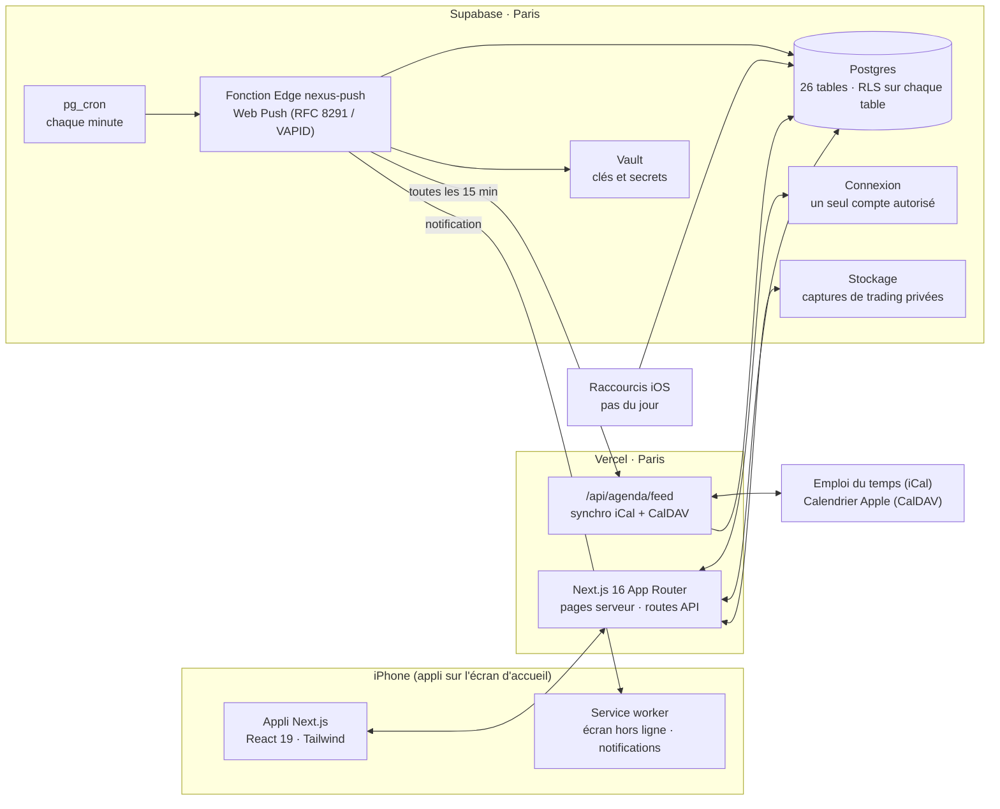

# NEXUS

**Mon organisation de vie dans une seule appli, construite pour moi et utilisée tous les jours.**
Agenda · Tâches et Top 3 · Habitudes · Journal du soir · Score et bilans · Journal de trading

*Appli web installable sur iPhone (PWA) · Next.js · Supabase · Vercel*

### [▶ Essayer la démo](https://nexus-maxime-demo.vercel.app) · [🎬 Voir la vidéo](LIEN_VIDEO)

*La démo utilise un compte fictif : tu peux tout toucher, rien n'est enregistré pour de vrai.*

---

## Pourquoi je l'ai construite

Je suis étudiant ingénieur en Data et IA. Ma journée était éparpillée dans six applis : l'emploi du temps de l'école, le Calendrier, une appli de tâches, des notes, un suivi d'habitudes et un tableur pour mes trades. Aucune ne parlait aux autres, et aucune ne me disait le soir si ma journée avait vraiment été bonne.

J'ai donc écrit le cahier des charges de l'outil que je voulais : **une seule appli qui prépare ma journée le matin, me garde sur les rails pendant la journée et me fait faire le bilan le soir.** Je l'utilise tous les jours sur mon iPhone depuis novembre 2026.

## Ce qu'elle fait

| Module | Ce qu'il fait |
|---|---|
| **Aujourd'hui** | Salutation, météo, cours en cours et suivant, **Top 3 des missions**, habitudes, score en direct |
| **Tâches** | Un réservoir avec étiquettes et dates limites. Glisser à droite pour la mettre aujourd'hui, appui long pour la modifier. Une mission pas faite revient dans le réservoir, sans culpabiliser |
| **Agenda** | Emploi du temps de l'école et Calendrier Apple réunis, mis à jour toutes les 15 min. Vues Jour, 3 jours, Semaine, Mois, avec zoom en pinçant. Une tâche peut être posée dans l'agenda |
| **Habitudes** | Habitudes oui/non avec séries 🔥, objectifs par semaine (sport 4 fois), habitudes avec heure limite (« couché avant 1 h »). Les pas du jour se cochent tout seuls depuis l'iPhone |
| **Journal du soir** | Un seul écran, pré-rempli avec le récap du jour : note sur 10, victoire, leçon, écriture libre. Calendrier du mois coloré selon la note, code à 4 chiffres en option |
| **Score et bilans** | Un point par chose utile faite. Graphe jour par jour sur la semaine, le mois ou l'année, comparaison avec la période d'avant, point faible |
| **Analyse** | Mes propres données passées au crible : quels jours, quelles étiquettes et quelles habitudes me rendent le plus productif |
| **Notifications** | Le plan du matin, « Fixe ton Top 3 », le rappel du journal, des rappels à la minute avec report, les bilans de la semaine et du mois, un mode vacances |
| **Journal de trading** | Un mode plein écran avec sa propre icône : plusieurs comptes, résultat en R par trade, sessions, captures, stats par setup, heure, jour et émotion, courbe du capital |

<!-- Captures : toutes prises sur la démo, avec des données fictives -->

  
  
  

  
  
  

## Architecture

**Les choix importants**

- **Next.js 16 (App Router), TypeScript, Tailwind v4.** Les données sont chargées côté serveur, le téléphone reçoit une page prête.
- **Supabase à Paris.** Postgres avec la sécurité RLS forcée sur chaque table, un seul compte autorisé, inscriptions fermées.
- **Des notifications à la minute, gratuitement.** Le cron gratuit de Vercel ne passe qu'une fois par jour. La planification vit donc dans Postgres (`pg_cron`, chaque minute) et appelle une fonction Edge qui chiffre elle-même les notifications (RFC 8291 / VAPID). Les clés sont rangées dans le coffre Supabase.
- **Une journée Nexus se termine à 3 h du matin**, pour qu'un journal écrit tard compte pour le bon jour.
- **Une appli web installable plutôt qu'une appli de l'App Store.** Elle s'installe depuis Safari, avec ses icônes, ses écrans de démarrage et une deuxième icône qui ouvre directement le mode trading.

## Méthode, et ce qu'a fait l'IA

Je veux être clair sur ce point.

**Ce que j'ai fait**
- J'ai défini le besoin et écrit tout le cahier des charges (fonctions, règles, écrans, cas particuliers).
- J'ai découpé le projet en phases et validé chacune avant de passer à la suivante.
- J'ai répondu aux questions de conception avant chaque phase (souvent plus de 30).
- J'ai testé chaque étape sur mon iPhone et renvoyé ce qui n'allait pas, jusqu'à ce que ce soit juste.
- J'ai pris les décisions produit, y compris retirer des fonctions : un module Projets, une liaison Notion et le suivi du temps d'écran, pour garder l'appli simple.

**Ce qu'a fait l'IA**
- [Claude](https://claude.ai) (Anthropic) a écrit le code, la base de données et la mise en ligne, à partir de mon cahier des charges et de mes retours.

Ce que j'en retiens, c'est la partie que l'IA ne fait pas à ta place : savoir exactement quoi construire, dire non à des fonctions, et juger si le résultat marche vraiment dans la vraie vie.

## Où en est le projet

Utilisée tous les jours depuis novembre 2026. Le code est privé car il contient mes données personnelles. La démo, les captures et la vidéo utilisent un compte avec **des données fictives**. Je peux faire une présentation ou donner accès au code sur demande.

**La suite :** l'import de mes séances de sport Hevy, l'export des données.

## Auteur

**Maxime Pierrard**, étudiant ingénieur Data et IA à l'ESIEE Paris.
[LinkedIn](https://www.linkedin.com/in/maxime-pierrard/)
